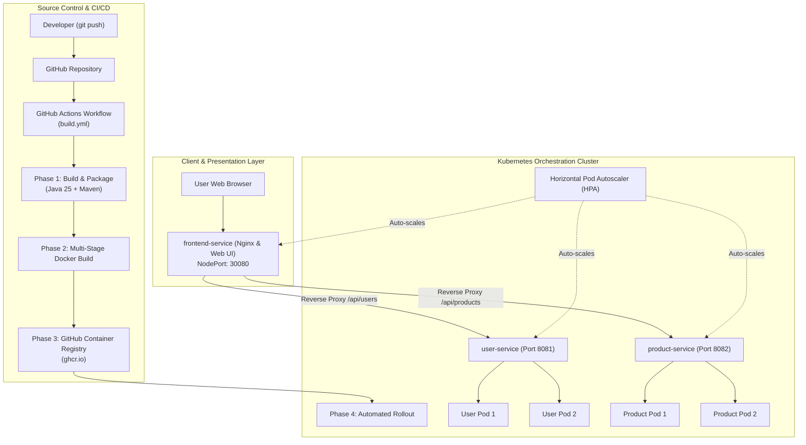

# Automated Microservices Deployment Using Docker and Kubernetes

An end-to-end DevOps project demonstrating automated building, containerization, and orchestration of cloud-native Spring Boot microservices with an **Interactive Showcase Dashboard**, **Docker**, **Kubernetes**, and **GitHub Actions CI/CD**.

---

## 🏛️ Architecture Overview



---

## 🖥️ Interactive Web Showcase Interface

This project includes a dedicated **Frontend Dashboard Service** ([`frontend-service/`](file:///c:/Users/1620g/microservices-project/frontend-service)) to showcase the **Input & Output** visually:

- **Input Display:** Shows the exact client HTTP request, target microservice, cluster port, and request headers.
- **Output Display:** Shows response status (200 OK), roundtrip latency (ms), rendered visual cards (Users & Products), and raw JSON syntax.
- **System Architecture Visualizer:** Shows real-time flow from Browser &rarr; Ingress/Nginx &rarr; Kubernetes Service &rarr; Docker Pod.
- **Live vs. Preview Mode:** Supports live connection to cluster pods with instant preview fallback for offline presentations.
- **Access URL:** `http://localhost:30080` (or open [`frontend-service/public/index.html`](file:///c:/Users/1620g/microservices-project/frontend-service/public/index.html) directly in any browser).

---

## 📦 Project Structure

```text
microservices-project/
├── .github/
│   └── workflows/
│       └── build.yml               # Automated CI/CD Workflow (Build -> GHCR -> K8s)
├── frontend-service/               # Showcase Web Interface & Reverse Proxy
│   ├── Dockerfile                  # Lightweight Nginx container
│   ├── nginx.conf                  # Reverse proxy config (/api/* -> cluster services)
│   └── public/
│       ├── index.html              # Modern dashboard UI
│       ├── style.css               # Responsive tech-theme styling
│       └── app.js                  # Interactive Input/Output executor
├── k8s/
│   ├── frontend-service-deployment.yaml # Frontend Pod deployment
│   ├── frontend-service-service.yaml    # NodePort 30080 exposure
│   ├── user-service-deployment.yaml     # Replicas, resource limits, liveness & readiness probes
│   ├── user-service-service.yaml        # User Service NodePort exposure
│   ├── product-service-deployment.yaml  # Replicas, resource limits, liveness & readiness probes
│   ├── product-service-service.yaml     # Product Service NodePort exposure
│   ├── ingress.yaml                     # Ingress routing rules (/, /users, /products)
│   └── hpa.yaml                         # Horizontal Pod Autoscaling policies
├── scripts/
│   ├── deploy.ps1                  # 1-Click deployment script for Windows PowerShell
│   └── deploy.sh                   # 1-Click deployment script for Linux/macOS
├── user-service/
│   ├── Dockerfile                  # Multi-stage Docker build (Maven + JRE 25)
│   ├── pom.xml                     # Spring Boot, WebMVC, and Actuator dependencies
│   └── src/                        # User Service source code & health probes
├── product-service/
│   ├── Dockerfile                  # Multi-stage Docker build (Maven + JRE 25)
│   ├── pom.xml                     # Spring Boot, WebMVC, and Actuator dependencies
│   └── src/                        # Product Service source code & health probes
└── README.md
```

---

## 🚀 Key Features by Phase

### Phase 1: Microservices Architecture
- **User Service:** REST API managing users (`/users`, `/users/{id}`).
- **Product Service:** REST API managing products (`/products`, `/products/{id}`).
- **Spring Boot Actuator:** Exposes `/actuator/health/liveness` and `/actuator/health/readiness` for Kubernetes lifecycle management.

### Phase 2: Containerization with Docker
- **Multi-Stage Builds:**
  - *Backend Services:* Uses `maven:3.9-eclipse-temurin-25` to compile and minimal `eclipse-temurin:25-jre` for runtime.
  - *Frontend Service:* Uses lightweight `nginx:alpine` (~20MB) to serve the UI and reverse-proxy API calls.

### Phase 3: Automated CI Pipeline
- Automatically triggered on `push` or `pull_request` to `main`.
- Compiles both backend services using Maven wrappers.
- Runs test and packaging validation.

### Phase 4: Container Registry Integration
- Docker images are tagged with both `latest` and commit SHA `${{ github.sha }}`.
- Automatically pushed to **GitHub Container Registry (GHCR)**:
  - `ghcr.io/g-vishnuvardhan/frontend-service:latest`
  - `ghcr.io/g-vishnuvardhan/user-service:latest`
  - `ghcr.io/g-vishnuvardhan/product-service:latest`

### Phase 5: Kubernetes Orchestration & Continuous Deployment (CD)
- **High Availability:** 2 pod replicas per microservice (6 pods total).
- **Self-Healing:** Configured with `livenessProbe` and `readinessProbe`.
- **Resource Management:** CPU and Memory requests and limits set for stability.
- **Autoscaling:** Horizontal Pod Autoscaler (`hpa.yaml`) dynamically scales pods based on CPU utilization.
- **Ingress & Networking:** Path-based routing rules redirecting traffic to internal services.

---

## 🛠️ How to Run Locally

### Option A: Using the Automated PowerShell Script (Windows)
```powershell
.\scripts\deploy.ps1
```

### Option B: Using the Bash Script (Linux/macOS)
```bash
chmod +x ./scripts/deploy.sh
./scripts/deploy.sh
```

### Option C: Quick Interface Preview
Double-click [`frontend-service/public/index.html`](file:///c:/Users/1620g/microservices-project/frontend-service/public/index.html) to open the interactive showcase directly in your browser.

---

## 🔍 API & Interface Endpoints

| Service | Method | Endpoint / Port | Description |
| :--- | :--- | :--- | :--- |
| **Web Dashboard** | GET | `http://localhost:30080` (NodePort) | Interactive Input & Output Showcase UI |
| **User Service** | GET | `/users` (Port 8081) | Retrieve list of all users |
| **User Service** | GET | `/actuator/health` | User Service health status |
| **Product Service** | GET | `/products` (Port 8082) | Retrieve list of all products |
| **Product Service** | GET | `/actuator/health` | Product Service health status |
