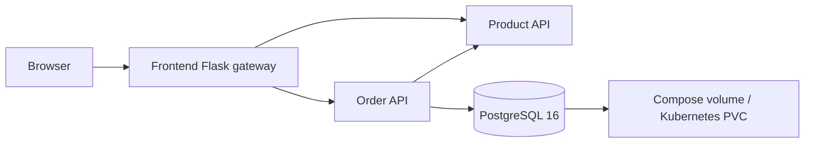

# CloudMart

**Automated Microservices Deployment Using Docker and Kubernetes**
College lab implementation by **K. Rishi · 24H51A05T6**

A working storefront with independent Flask services, server-validated checkout, PostgreSQL persistence, Docker Compose, Kubernetes manifests and deployment automation. A clearly labelled SQLite mode supports an application demonstration when Docker is unavailable.

## Quick start on Windows

Open a terminal in this folder. Start Docker Desktop and wait until `docker info` succeeds.

```powershell
Copy-Item .env.example .env
# Edit .env and choose a local lab password before the first database start.
docker compose up -d --build --wait --wait-timeout 240
```

Open **http://localhost:5000**. Or use `./scripts/deploy.ps1 -Mode Compose` for preflight checks and health verification.

For Kubernetes, enable Docker Desktop Kubernetes and select its local context:

```powershell
kubectl config use-context docker-desktop
./scripts/deploy.ps1 -DbPassword 'your-local-lab-password'
```

Open **http://localhost:30080**. The script also supports local Minikube and Kind contexts. For portable access, run `kubectl port-forward -n microservices-lab svc/frontend-service 5000:80` in a second terminal, then open port 5000. Stop the local demo first if it occupies that port.

Linux/macOS: `bash scripts/deploy.sh compose` or `DB_PASSWORD='your-local-lab-password' bash scripts/deploy.sh kubernetes`.

## Without Docker

Python 3.11 or later is required. This runs real services with SQLite storage, not simulated Kubernetes telemetry.

```powershell
python -m venv .venv
.venv/Scripts/python -m pip install -r services/order-service/requirements.txt
.venv/Scripts/python scripts/run-local.py
```

Open http://localhost:5000. Keep the terminal running. Press Ctrl+C to stop. On Linux/macOS, use `.venv/bin/python`. The database file `cloudmart-demo.db` persists across local runs and is excluded from the submission ZIP.

## What works

- Responsive product catalog, search and category filters.
- Cart quantity controls, locally saved cart and light/dark themes.
- Server-side bill calculation using Decimal. Browser-supplied prices cannot change the bill.
- Idempotent checkout: retrying an identical request key returns the original order.
- Shared order history with database persistence.
- Live inspector with actual backend readiness, responding hosts and measured internal latency.
- Multi-stage images, non-root app users, health checks and internal Compose networking.
- Dedicated Kubernetes namespace, ConfigMap, generated Secret, 1 Gi PVC, deployments, internal services, frontend NodePort, probes, resource limits and HPA definitions.
- Windows and Bash deployment/cleanup scripts and a bounded traffic generator.
- CI pipeline for lint checks, tests, container builds and a disposable Kind deployment rehearsal.

## Architecture



| Component | Internal port | Responsibility |
|---|---:|---|
| Frontend | 5000 | UI, API gateway, service inspector |
| Product service | 5001 | Seeded catalog and quantity validation data |
| Order service | 5002 | Validate cart, calculate bill, store orders |
| PostgreSQL | 5432 | Persistent order records |

Only the frontend publishes a host port in Compose. Kubernetes backend services use ClusterIP. Frontend uses NodePort 30080 with service port 80.

## Documentation

- [College demonstration guide](DEMO_GUIDE.md)
- [Lab manual](LAB_MANUAL.md)
- [Academic project report](PROJECT_REPORT.md)
- [25 viva questions and answers](VIVA_QUESTIONS.md)
- [Design references](DESIGN_REFERENCES.md)
- [Recorded verification status](VERIFICATION.md)

## Important operating details

This is an educational lab, not a production commerce platform. It has no authentication, real payments or transactional inventory reservation. Quantities are checked against seeded stock, but checkout does not decrement stock. Order history is shared. Production would need per-user authorization, HTTPS, a migration system, stronger secret management, monitoring and database backups/replication.

The inspector does not have Kubernetes API credentials. It cannot report replica counts or CPU metrics. Obtain those using `kubectl get pods,hpa` and `kubectl top pods`.

HPA requires a working Metrics Server and sustained CPU load. The demo load endpoint is enabled only in the supplied isolated Docker/Kubernetes lab configuration and disabled in local mode. Disable `ENABLE_LOAD_DEMO` before exposing the application beyond a trusted lab.

Keep the initial database password when reusing a volume. Changing an environment variable does not rotate an existing PostgreSQL user's password. Default cleanup retains data. `-DeleteData` or `--delete-data` deliberately removes it, subject to the storage class reclaim policy.

## Verification commands

```powershell
python -m pip install pytest
python -m pytest -q
python scripts/smoke-test.py http://localhost:5000
kubectl kustomize k8s
docker compose config --quiet
```

The smoke test places a disposable demonstration order. CI rehearses Kubernetes deployment on an ephemeral Kind cluster. No image publishing or deployment to a permanent remote cluster is configured.

## Original repository

The supplied repository's original Spring Boot showcase is preserved in `legacy/`, including its deployment definitions. The active CloudMart code lives in `services/`, `k8s/`, and `scripts/`. The existing root static pages and Vercel configuration remain as the original web showcase; run CloudMart through the deployment instructions above. Do not apply the legacy manifests together with CloudMart. This deliverable is a local implementation based on the supplied repository. GitHub delivery uses the repository commit history. Container deployment remains a separate step.

Original: https://github.com/g-vishnuvardhan/microservices-project
