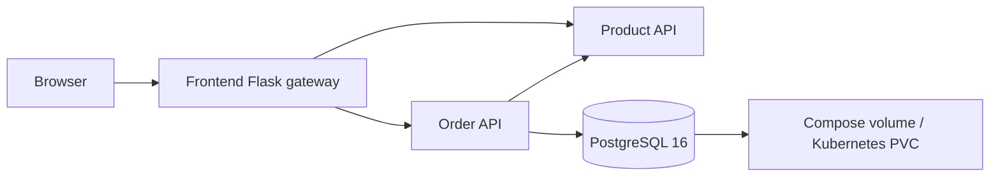

# CloudMart

**Automated Microservices Deployment Using Docker and Kubernetes**
College lab implementation by **K. Rishi · 24H51A05T6**

A working storefront with independent Flask services, server-validated checkout, PostgreSQL persistence, Docker Compose, Kubernetes manifests and deployment automation. A clearly labelled SQLite mode supports an application demonstration when Docker is unavailable.

## Required tools

| Tool | When it is required | Purpose / installation |
|---|---|---|
| Git | All modes | Clone and update the project. [Install Git](https://git-scm.com/downloads/) |
| Docker Desktop with Linux containers and Docker Compose v2 | Compose and local Kubernetes | Build images, run containers and host the local cluster. [Windows setup](https://docs.docker.com/desktop/setup/install/windows-install/) |
| kubectl | Kubernetes | Apply manifests and inspect pods, services, PVCs and HPA. [Windows installation](https://kubernetes.io/docs/tasks/tools/install-kubectl-windows/) |
| Kind, Docker Desktop Kubernetes, or Minikube | Kubernetes; choose one | Provide a local Kubernetes cluster. This project's verified setup uses **Kind 0.33.0 / Kubernetes 1.36.1**. [Kind setup](https://kind.sigs.k8s.io/docs/user/quick-start/) |
| Metrics Server | Kubernetes autoscaling demonstration | Supply CPU measurements to HPA. [Official installation and requirements](https://github.com/kubernetes-sigs/metrics-server) |
| PowerShell 7 (`pwsh`) | Windows parallel traffic test | Run deployment scripts and the `ForEach-Object -Parallel` load generator. [Install PowerShell 7](https://learn.microsoft.com/en-us/powershell/scripting/install/install-powershell-on-windows) |
| Python 3.11+ and pip | Python fallback, automated tests and smoke-test script | Run Flask locally or execute verification. Host Python is optional for container-only browser use. [Install Python](https://www.python.org/downloads/) |
| A web browser | All modes | Use the storefront and show the demonstration. |

For Windows, follow Docker's supported OS, WSL 2 and virtualization requirements
in the installation link above. Use a machine with at least 8 GB RAM and enough
free disk space for Docker images and the cluster; reserve additional resources
when running Compose and Kubernetes together. Internet access is needed for the
first image/tool downloads. A Kubernetes cluster also needs a default dynamic
StorageClass to bind the project's 1 Gi PVC.

**You do not need to install PostgreSQL, Flask, Bootstrap, Java, or Maven on the
host for the container deployment.** PostgreSQL runs in its own container; Python
packages are installed during the Docker builds. Java/Maven belong to the
preserved `legacy/` implementation.

Check the tools for the mode you choose:

```powershell
git --version
docker info
docker compose version
# Kubernetes mode:
kubectl version --client
kind version                 # When using Kind
$PSVersionTable.PSVersion    # Major version 7 for the load test
# Python fallback or tests:
python --version
```

## Get the project and choose a mode

```powershell
git clone https://github.com/g-vishnuvardhan/microservices-project.git
Set-Location microservices-project
```

Run all following commands from the repository root. If you already cloned the
project, open that checkout and run `git pull --ff-only` instead of cloning again.

| Mode | What it demonstrates | Browser URL |
|---|---|---|
| Docker Compose | Real services, Docker networking and PostgreSQL persistence | http://localhost:5000 |
| Kubernetes with the supplied Kind port mapping | Pods, service discovery, probes, PVC, self-healing and HPA | http://localhost:30080 |
| Local Python | Application behavior with SQLite storage | http://localhost:5000 |

Compose and the local Python mode both use port 5000, so run only one of those
at a time. Compose and the mapped Kind cluster can run together, but their
databases and order histories are separate. The root `index.html` and Vercel site
are the original static showcase; use the URLs above for the working CloudMart app.

## Run with Docker Compose

Start Docker Desktop and wait until `docker info` succeeds. Create `.env` only
if it does not already exist, then edit its `DB_PASSWORD` before the first start:

```powershell
if (-not (Test-Path .env)) { Copy-Item .env.example .env }
# Open .env in your editor and choose a local lab password.
docker compose config --quiet
docker compose up -d --build --wait --wait-timeout 240
docker compose ps
Invoke-RestMethod http://127.0.0.1:5000/api/inspector
```

Open **http://localhost:5000**. All four containers should be healthy; the inspector
should report `docker-compose`, healthy backends and `postgresql` storage. First
startup takes longer while images and dependencies download. Subsequent runs
reuse the image cache and database volume. `.env` is ignored by Git.

Alternatively, use `./scripts/deploy.ps1 -Mode Compose` for the supplied preflight
checks and health verification. Keep the same password when reusing a database
volume. Linux/macOS users can run `bash scripts/deploy.sh compose` after creating
their `.env` file.

## Run with Kubernetes

### Use the already configured local cluster

The verified development machine has a running Kind cluster. Start Docker
Desktop, select its context and check readiness:

```powershell
kubectl config use-context kind-cloudmart
kubectl cluster-info
kubectl get nodes
kubectl get pods,svc,pvc,hpa -n microservices-lab
kubectl top pods -n microservices-lab
Invoke-RestMethod http://127.0.0.1:30080/api/inspector
```

Open **http://localhost:30080**. Expect `kubernetes` in the inspector, seven ready
application pods at idle (2 frontend, 2 product, 2 order and 1 PostgreSQL), a Bound
PVC, and both HPA resources at 2 replicas. This is a local cluster inside Docker,
not a deployment to an external cloud account.

### Set up Kind on a new Windows machine

Install Kind and put `kind.exe` on your PATH, then start Docker Desktop. On the
verified development machine, Kind was installed in
`$env:LOCALAPPDATA\CloudMart\tools`; if needed, add that folder to the current
terminal session with `$env:Path += ";$env:LOCALAPPDATA\CloudMart\tools"`.

Create the cluster **only if `kind get clusters` does not already list `cloudmart`**:

```powershell
kind get clusters
kind create cluster --name cloudmart --image kindest/node:v1.36.1 --config scripts/kind-config.yaml --wait 120s
kubectl config use-context kind-cloudmart
```

The configuration maps NodePort 30080 to loopback and enables kubelet serving
certificate bootstrap. Build the app images, pull PostgreSQL, and import only
the Linux AMD64 platform for this x86-64 lab setup:

```powershell
docker build -t cloudmart-frontend:v1 services/frontend
docker build -t cloudmart-product:v1 services/product-service
docker build -t cloudmart-order:v1 services/order-service
docker pull --platform linux/amd64 postgres:16-alpine
$archive = Join-Path $env:TEMP 'cloudmart-images-amd64.tar'
docker image save --platform linux/amd64 -o $archive cloudmart-frontend:v1 cloudmart-product:v1 cloudmart-order:v1 postgres:16-alpine
kind load image-archive $archive --name cloudmart
```

Create the namespace and database Secret, then apply the workloads. The entered
password is a local runtime value; do not add it to the repository. For an
existing PVC, enter its original database password:

```powershell
kubectl apply -f k8s/00-namespace.yaml
$dbPassword = Read-Host 'Enter the local Kubernetes database password'
kubectl create secret generic cloudmart-secret -n microservices-lab "--from-literal=DB_PASSWORD=$dbPassword" --dry-run=client -o yaml | kubectl apply -f -
Remove-Variable dbPassword
kubectl apply -k k8s
foreach ($name in @('postgres-db','product-service','order-service','frontend-service')) {
    kubectl rollout status "deployment/$name" -n microservices-lab --timeout=240s
}
kubectl get pods,svc,pvc,hpa -n microservices-lab
```

Open http://localhost:30080. After importing rebuilt app images with the same
tags, run `kubectl rollout restart deployment/frontend-service deployment/product-service deployment/order-service -n microservices-lab` so pods use the new images.

For HPA, install Metrics Server with trusted kubelet TLS on this Kind cluster:

```powershell
kubectl get csr
kubectl get node cloudmart-control-plane -o wide
```

Identify the pending CSR whose signer is `kubernetes.io/kubelet-serving` and whose
requestor is `system:node:cloudmart-control-plane`. Inspect it **before approval**:

```powershell
$csrName = Read-Host 'Enter the pending kubelet-serving CSR name'
$csr = kubectl get csr $csrName -o json | ConvertFrom-Json
[System.Text.Encoding]::ASCII.GetString([Convert]::FromBase64String($csr.spec.request)) | docker exec -i cloudmart-control-plane openssl req -noout -text
# Confirm the subject is the intended node and the DNS/IP SANs match the node above.
kubectl certificate approve $csrName
```

Approve only that verified node serving request. Install the pinned Metrics
Server release and configure it to trust the cluster CA:

```powershell
kubectl apply -f https://github.com/kubernetes-sigs/metrics-server/releases/download/v0.9.0/components.yaml
$metricsPatch = @'
[{"op":"add","path":"/spec/template/spec/containers/0/args/-","value":"--kubelet-certificate-authority=/var/run/secrets/kubernetes.io/serviceaccount/ca.crt"}]
'@
$patchFile = Join-Path $env:TEMP 'cloudmart-metrics-ca-patch.json'
Set-Content -LiteralPath $patchFile -Value $metricsPatch -Encoding utf8
kubectl patch deployment metrics-server -n kube-system --type=json --patch-file $patchFile
kubectl rollout status deployment/metrics-server -n kube-system --timeout=120s
kubectl top pods -n microservices-lab
```

Allow initial metric collection before testing HPA. Keep TLS verification
enabled. Future kubelet serving-certificate renewals in this local setup also
require verified CSR approval. For other cluster types, follow their certificate
and Metrics Server installation procedures.

### Docker Desktop Kubernetes or Minikube alternative

For Docker Desktop's built-in Kubernetes, enable it in Docker Desktop first:

```powershell
kubectl config use-context docker-desktop
kubectl cluster-info
./scripts/deploy.ps1 -DbPassword 'replace-with-your-local-lab-password'
```

For Minikube, start its cluster, select the `minikube` context, and use the same
deployment script; its image loader handles Minikube. Enable its metrics addon
with `minikube addons enable metrics-server`. Obtain the app URL using
`minikube service frontend-service -n microservices-lab --url`.

The generic deployment scripts also accept Kind contexts, but their default Kind
access advice uses port-forwarding. Use the mapped port 30080 for the Kind setup
above. Linux/macOS can use
`DB_PASSWORD='your-local-lab-password' bash scripts/deploy.sh kubernetes` with a
supported running local cluster.

If a NodePort is inaccessible, keep this command running in a second terminal:

```powershell
kubectl port-forward -n microservices-lab svc/frontend-service 5003:80
```

Open http://localhost:5003 while the terminal stays running. This avoids port
5000 if Compose is also running. Use the mapped NodePort for a load-balancing
demonstration: port-forwarding connects to a selected pod.

## Run without Docker

Python 3.11 or later is required. This runs real services with SQLite storage, not simulated Kubernetes telemetry.

```powershell
python -m venv .venv
.venv/Scripts/python -m pip install -r services/order-service/requirements.txt
.venv/Scripts/python scripts/run-local.py
```

Open http://localhost:5000. Keep the terminal running. Press Ctrl+C to stop. On Linux/macOS, use `.venv/bin/python`. The database file `cloudmart-demo.db` persists across local runs and is excluded from the submission ZIP.

## How to use the application

1. Open the URL for your running mode and select **Product catalog**.
2. Search or filter a category, then add products to **Your bag**. Change their
   quantities and check the total.
3. Select **Place order**. The order service validates product IDs, quantities
   and catalog prices, calculates the bill, and stores the completed order.
   This is demo checkout; no payment or personal details are required.
4. Select **Order history** and **Refresh orders**. Note an order ID to use in
   the persistence demonstration. Reloading the browser should keep the order.
5. Open **Live inspector**. Show the deployment mode, backend readiness,
   responding hosts, internal request latency and storage type. Use `kubectl`
   for actual pod counts and CPU; the browser inspector does not query the
   Kubernetes API.
6. Use the theme switch and **Demo guide** tab when presenting the interface.

Do not promise that every browser refresh changes the serving pod. Connection
reuse and Kubernetes networking can route consecutive requests to the same pod.

## How to present the project

Prepare before class: start Docker and the chosen cluster, check all pods are
ready, verify `kubectl top pods` works, and open the browser plus two PowerShell 7
terminals. Increase terminal text size and keep this README and
[the demo guide](DEMO_GUIDE.md) available. Test downloads and setup in advance.

Use this approximately 10-minute presentation:

| Time | What to show | What to explain |
|---|---|---|
| 0:00–1:00 | Architecture diagram below | The frontend, catalog and order services communicate through APIs; PostgreSQL stores orders. Docker packages them and Kubernetes manages them. |
| 1:00–3:00 | Catalog → Your bag → Place order → Order history | The client sends IDs and quantities; server-side catalog prices determine the bill. |
| 3:00–4:00 | Live inspector and `kubectl get pods,svc,pvc,hpa -n microservices-lab` | Internal service DNS, readiness, multiple replicas and persistent storage. |
| 4:00–5:00 | Delete one frontend pod while watching pods | The Deployment restores its desired replica count; compare old and replacement pod names. |
| 5:00–6:00 | Restart PostgreSQL and recheck the noted order ID | The PVC preserves database files even though the database pod is replaced. |
| 6:00–8:00 | Run the two-minute traffic script and watch HPA | Metrics Server supplies CPU data; HPA adds pods when sustained CPU exceeds its target. |
| 8:00–10:00 | Watch automatic scale-down and show verification results | The cooldown prevents rapid scaling changes. Summarize observed recovery, persistence and scaling. |

Suggested opening: **“CloudMart is an automated microservices deployment lab.
Docker packages each service. Kubernetes manages its replicas, readiness,
recovery and scaling. PostgreSQL and a persistent volume keep order data across
pod restarts.”**

### Demonstrate self-healing

In terminal 1:

```powershell
kubectl get pods -n microservices-lab -l app=frontend-service -w
```

In terminal 2:

```powershell
$demoPod = kubectl get pods -n microservices-lab -l app=frontend-service -o jsonpath='{.items[0].metadata.name}'
kubectl delete pod $demoPod -n microservices-lab
kubectl wait --for=condition=Ready pods -l app=frontend-service -n microservices-lab --timeout=120s
kubectl get pods -n microservices-lab -l app=frontend-service
Invoke-RestMethod http://127.0.0.1:30080/healthz
```

Show the replacement's new name and `1/1 Running` state. Refresh the application
during recovery. This demonstrates recovery from losing one pod on a healthy
node; the local single-node cluster does not demonstrate whole-node failover.
Use Ctrl+C to stop terminal 1's watch.

### Demonstrate persistence

Place an order first and record its ID. Then run:

```powershell
kubectl get pvc -n microservices-lab
kubectl rollout restart deployment/postgres-db -n microservices-lab
kubectl rollout status deployment/postgres-db -n microservices-lab --timeout=120s
kubectl wait --for=condition=Ready pods -l app=order-service -n microservices-lab --timeout=120s
Invoke-RestMethod http://127.0.0.1:30080/api/inspector
```

Wait until the order service reports healthy, then refresh **Order history**.
Show that the same order ID remains. A single PostgreSQL pod has a brief outage
during restart; the PVC provides persistence, not database high availability.
Do not delete the PVC for this test.

### Demonstrate autoscaling

Check metrics first. CPU must show a number rather than `<unknown>`:

```powershell
kubectl top pods -n microservices-lab
kubectl get hpa -n microservices-lab
```

In terminal 1:

```powershell
kubectl get hpa -n microservices-lab -w
```

In terminal 2, using PowerShell 7:

```powershell
.\scripts\test-traffic.ps1 -BaseUrl http://127.0.0.1:30080 -Seconds 120 -Concurrency 16
kubectl get deployments -n microservices-lab
kubectl describe hpa order-service -n microservices-lab
```

Explain the **50% CPU target**, **2 minimum replicas**, and **5 maximum replicas**.
The CPU percentage is relative to each pod's 50m CPU request. The load endpoint
performs CPU work in the order service, so it usually scales more strongly than
the frontend. One request does not guarantee scaling. After traffic stops,
allow the configured 120-second scale-down stabilization window plus metric and
controller delays. The [HPA documentation](https://kubernetes.io/docs/concepts/workloads/autoscaling/horizontal-pod-autoscale/)
explains this behavior. Stop the watch with Ctrl+C.

### Results to show the examiner

The local Kubernetes run on **12 October 2026** verified:

| Demonstration | Observed result |
|---|---|
| Application | Catalog, checkout, server pricing, retry and order history passed with PostgreSQL |
| Self-healing | Replacement pod ready in 10.7 seconds; all 39 sampled health requests succeeded |
| Autoscaling | Order service 2 → 4 → 5 pods; frontend 2 → 3 pods |
| Load generator | 2,315 successful requests and zero failures over 120 seconds with 16 workers |
| Scale-down | Both services automatically returned to 2 replicas in about 2.5 minutes |

These are recorded results, not a guarantee of identical timing on every
computer. See [VERIFICATION.md](VERIFICATION.md) for the full record and
[VIVA_QUESTIONS.md](VIVA_QUESTIONS.md) for 25 questions and answers. If using
Compose or Python only, demonstrate the application and storage supported by
that mode, and explain Kubernetes using the manifests rather than presenting
its behavior as observed.

## Stop and restart the project

For Compose, this stops containers and preserves the database volume:

```powershell
docker compose down
# Start again with the same .env password:
docker compose up -d --wait --wait-timeout 240
```

For Kubernetes, the provided cleanup script removes application Deployments,
Services and HPA while retaining the namespace, Secret and PVC:

```powershell
kubectl config use-context kind-cloudmart
.\scripts\cleanup.ps1 -Mode Kubernetes
# Redeploy using the retained Secret, PVC and loaded images:
kubectl apply -k k8s
```

Use cleanup only after finishing the presentation. The cluster and Metrics
Server remain running. `-DeleteData` (or `--delete-data` in Bash), `docker compose
down --volumes`, or deleting the Kind cluster intentionally removes lab data,
subject to storage reclaim behavior. Local Python mode stops with Ctrl+C.

## Troubleshooting

| Symptom | Check / action |
|---|---|
| Docker daemon unavailable | Start Docker Desktop, select Linux containers and wait for `docker info` to succeed. |
| `kind` is not recognized | Put the installed binary on PATH; the development machine's tool location is documented above. |
| No Kubernetes API connection | Use `kubectl config get-contexts`, select the intended local cluster, then check `kubectl cluster-info`. |
| `ImagePullBackOff` | Verify image tags, import the images into Kind, and inspect `kubectl describe pod <pod-name> -n microservices-lab`. |
| PVC stays Pending | Check `kubectl get storageclass` and `kubectl describe pvc db-data-pvc -n microservices-lab`. |
| Database authentication failure | Reuse the original password for existing data; changing a Secret or `.env` does not rotate PostgreSQL's stored password. |
| HPA CPU is `<unknown>` | Check `kubectl top pods`, Metrics Server logs and verified kubelet serving certificates; allow initial metrics collection. |
| Port 30080 does not respond | Confirm pods and service readiness; use the port-forward command above if your cluster lacks host port mapping. |
| Checkout temporarily fails | Check the inspector and order-service logs, wait for dependency readiness, and retry with the preserved cart. |

Useful diagnostics:

```powershell
docker compose logs --tail 50
kubectl get events -n microservices-lab --sort-by=.metadata.creationTimestamp
kubectl logs deployment/order-service -n microservices-lab --tail=50
```

## What works

- Responsive product catalog, search and category filters.
- Cart quantity controls, locally saved cart and light/dark themes.
- Server-side bill calculation using Decimal. Browser-supplied prices cannot change the bill.
- Idempotent checkout: retrying an identical request key returns the original order.
- Shared order history with database persistence.
- Live inspector with actual backend readiness, responding hosts and measured internal latency.
- Multi-stage images, non-root app users, health checks and internal Compose networking.
- Dedicated Kubernetes namespace, ConfigMap, generated Secret, 1 Gi PVC, deployments, internal services, frontend NodePort, probes, resource limits and HPA definitions.
- Windows and Bash deployment/cleanup scripts and a bounded traffic generator.
- CI pipeline for lint checks, tests, container builds and a disposable Kind deployment rehearsal.

## Architecture



| Component | Internal port | Responsibility |
|---|---:|---|
| Frontend | 5000 | UI, API gateway, service inspector |
| Product service | 5001 | Seeded catalog and quantity validation data |
| Order service | 5002 | Validate cart, calculate bill, store orders |
| PostgreSQL | 5432 | Persistent order records |

Only the frontend publishes a host port in Compose. Kubernetes backend services use ClusterIP. Frontend uses NodePort 30080 with service port 80.

## Documentation

- [College demonstration guide](DEMO_GUIDE.md)
- [Lab manual](LAB_MANUAL.md)
- [Academic project report](PROJECT_REPORT.md)
- [25 viva questions and answers](VIVA_QUESTIONS.md)
- [Design references](DESIGN_REFERENCES.md)
- [Recorded verification status](VERIFICATION.md)

## Important operating details

This is an educational lab, not a production commerce platform. It has no authentication, real payments or transactional inventory reservation. Quantities are checked against seeded stock, but checkout does not decrement stock. Order history is shared. Production would need per-user authorization, HTTPS, a migration system, stronger secret management, monitoring and database backups/replication.

The inspector does not have Kubernetes API credentials. It cannot report replica counts or CPU metrics. Obtain those using `kubectl get pods,hpa` and `kubectl top pods`.

HPA requires a working Metrics Server and sustained CPU load. The demo load endpoint is enabled only in the supplied isolated Docker/Kubernetes lab configuration and disabled in local mode. Disable `ENABLE_LOAD_DEMO` before exposing the application beyond a trusted lab.

Keep the initial database password when reusing a volume. Changing an environment variable does not rotate an existing PostgreSQL user's password. Default cleanup retains data. `-DeleteData` or `--delete-data` deliberately removes it, subject to the storage class reclaim policy.

## Verification commands

Use a Python environment with the project's dependencies installed:

```powershell
python -m venv .venv
.venv/Scripts/python -m pip install -r services/order-service/requirements.txt pytest
.venv/Scripts/python -m pytest -q
.venv/Scripts/python scripts/smoke-test.py http://127.0.0.1:30080
kubectl kustomize k8s
docker compose config --quiet
```

Use port 5000 in the smoke-test command for Compose or local Python mode, and
`.venv/bin/python` on Linux/macOS. `docker compose config` requires the `.env`
file described above. The smoke test places a disposable demonstration order.
CI rehearses Kubernetes deployment on an ephemeral Kind cluster. No image
publishing or deployment to a permanent remote cluster is configured.

## Original repository

The supplied repository's original Spring Boot showcase is preserved in `legacy/`, including its deployment definitions. The active CloudMart code lives in `services/`, `k8s/`, and `scripts/`. The existing root static pages and Vercel configuration remain as the original web showcase; run CloudMart through the deployment instructions above. Do not apply the legacy manifests together with CloudMart. This deliverable is a local implementation based on the supplied repository. GitHub delivery uses the repository commit history. Container deployment remains a separate step.

Original: https://github.com/g-vishnuvardhan/microservices-project
