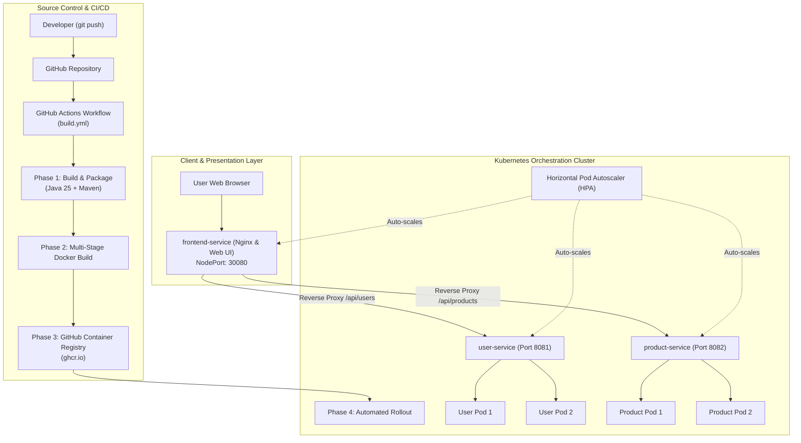

# Automated Microservices Deployment Using Docker and Kubernetes

[](https://github.com/g-vishnuvardhan/microservices-project/actions/workflows/build.yml)
[](https://kubernetes.io/)
[](https://www.docker.com/)
[](https://openjdk.org/)
[](https://spring.io/projects/spring-boot)
[](https://microservices-project-sooty.vercel.app/)

An end-to-end cloud-native microservices engineering project demonstrating automated containerization, Kubernetes cluster orchestration, and automated CI/CD pipelines.

---

## Architecture Overview



---

## Interactive Web Showcase Interface

This project includes a dedicated **Frontend Dashboard Service** ([`frontend-service/`](file:///c:/Users/1620g/microservices-project/frontend-service)):
- **Input & Output Console:** Inspect real HTTP request payloads, target microservices, cluster ports, headers, response status codes, and round-trip latencies.
- **Microservices Data:** Query `user-service` and `product-service` entities with live and preview modes.
- **Actuator Health Probes:** Inspect Kubernetes liveness and readiness states directly via Spring Boot Actuator endpoints.
- **Live Deployment:** Accessible on Vercel at [https://microservices-project-sooty.vercel.app/](https://microservices-project-sooty.vercel.app/) and locally on Kubernetes at `http://localhost:30080`.

---

## Academic Lab Deliverables

- 📖 [**LAB_MANUAL.md**](LAB_MANUAL.md): Comprehensive university laboratory manual (Aim, Theory, Step-by-Step Procedure, Expected Output, and Troubleshooting).
- 💡 [**VIVA_QUESTIONS.md**](VIVA_QUESTIONS.md): Top 25 high-frequency Viva Voce questions with detailed technical answers on Docker and Kubernetes.
- 📝 [**PROJECT_REPORT.md**](PROJECT_REPORT.md): Ready-to-submit formal Academic Project Report.

---

## Project Structure

```text
microservices-project/
├── .github/
│   └── workflows/
│       └── build.yml               # Automated CI/CD Workflow (Build -> GHCR -> K8s)
├── frontend-service/               # Showcase Web Interface & Reverse Proxy
│   ├── Dockerfile                  # Lightweight Nginx container
│   ├── nginx.conf                  # Reverse proxy config (/api/* -> cluster services)
│   └── public/
│       ├── index.html              # Professional UI dashboard
│       ├── style.css               # Clean, responsive styling
│       ├── app.js                  # Request/Response execution logic
│       ├── privacy.html            # Privacy Policy
│       ├── terms.html              # Terms and Conditions
│       └── favicon.svg             # Vector favicon
├── k8s/
│   ├── frontend-service-deployment.yaml # Frontend Pod deployment (2 replicas)
│   ├── frontend-service-service.yaml    # NodePort 30080 exposure
│   ├── user-service-deployment.yaml     # User service replicas & probes
│   ├── user-service-service.yaml        # User service ClusterIP/NodePort exposure
│   ├── product-service-deployment.yaml  # Product service replicas & probes
│   ├── product-service-service.yaml     # Product service ClusterIP/NodePort exposure
│   ├── ingress.yaml                     # Ingress routing rules
│   └── hpa.yaml                         # Horizontal Pod Autoscaling policies
├── scripts/
│   ├── deploy.ps1                  # 1-Click deployment script (PowerShell)
│   ├── deploy.sh                   # 1-Click deployment script (Bash)
│   ├── cleanup.ps1                 # Teardown script (PowerShell)
│   ├── cleanup.sh                  # Teardown script (Bash)
│   └── test-traffic.ps1            # HPA load generator & stress testing tool
├── user-service/
│   ├── Dockerfile                  # Multi-stage Docker build (Maven + JRE 25)
│   ├── pom.xml                     # Spring Boot, WebMVC, and Actuator dependencies
│   └── src/                        # User Service source code & health probes
├── product-service/
│   ├── Dockerfile                  # Multi-stage Docker build (Maven + JRE 25)
│   ├── pom.xml                     # Spring Boot, WebMVC, and Actuator dependencies
│   └── src/                        # Product Service source code & health probes
├── vercel.json                     # Vercel deployment configuration
├── index.html                      # Root web entrypoint for Vercel
├── privacy.html                    # Root privacy policy
├── terms.html                      # Root terms and conditions
├── favicon.svg                     # Root favicon
└── README.md
```

---

## Quick Start: Automated Deployment

### Option A: Using PowerShell (Windows)
```powershell
.\scripts\deploy.ps1
```

### Option B: Using Bash (Linux/macOS)
```bash
chmod +x ./scripts/deploy.sh
./scripts/deploy.sh
```

---

## API & Interface Endpoints

| Service | Method | Endpoint / Port | Description |
| :--- | :--- | :--- | :--- |
| **Web Dashboard** | GET | `http://localhost:30080` (NodePort) | Interactive Input & Output Console |
| **User Service** | GET | `/api/users` (Port 8081) | Retrieve list of all users |
| **User Service** | GET | `/api/health/users` | User Service Actuator health probe |
| **Product Service** | GET | `/api/products` (Port 8082) | Retrieve list of all products |
| **Product Service** | GET | `/api/health/products` | Product Service Actuator health probe |
