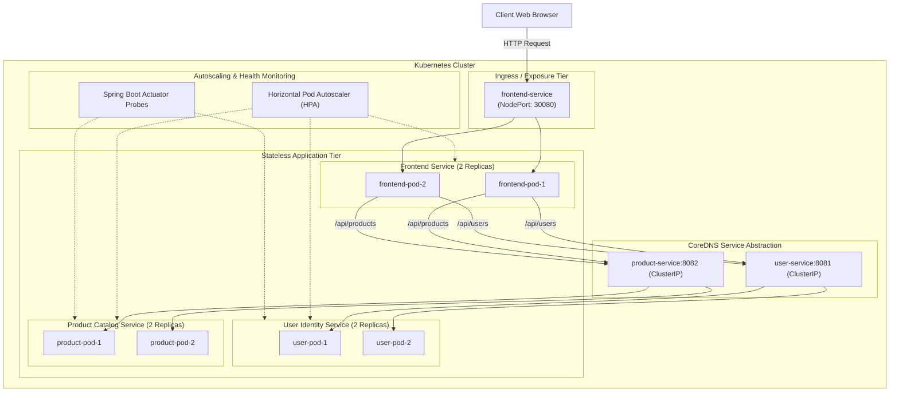

# ACADEMIC PROJECT REPORT

## PROJECT TITLE:
### **Automated Microservices Deployment and Orchestration Using Docker, Kubernetes, and CI/CD**

---

### **CANDIDATE & LAB DETAILS:**
- **Course:** B.Tech / B.E. / BCA / MCA in Computer Science & Engineering
- **Subject:** Cloud Computing & Distributed Systems / DevOps Laboratory
- **Project Domain:** Cloud Native Architecture, Container Orchestration, Automation Pipelines

---

## 1. ABSTRACT
Modern software engineering has shifted away from monolithic architectures toward modular, cloud-native microservices. While microservices provide organizational scalability and domain isolation, managing distributed deployments introduces significant operational challenges, including service discovery, inter-service networking, fault tolerance, and load balancing.

This project implements an end-to-end distributed microservices platform comprising two core Spring Boot backend services (**User Identity Service** and **Product Catalog Service**) integrated with an **Nginx-based Frontend Service**. All services are containerized using secure multi-stage Docker configurations and orchestrated on a Kubernetes cluster. 

The deployment process is automated through declarative manifests, cross-platform automation scripts (`deploy.ps1` and `deploy.sh`), and a comprehensive GitHub Actions CI/CD pipeline that compiles artifacts, builds multi-stage images, pushes them to GitHub Container Registry (GHCR), and validates deployment on an automated Kind cluster.

---

## 2. INTRODUCTION & PROBLEM STATEMENT

### 2.1 The Monolithic Bottleneck
In traditional monolithic architectures:
1. **Tight Coupling:** Components share the same runtime process and memory space; a fault in one module brings down the entire application.
2. **Inflexible Scaling:** Scaling a resource-intensive component requires scaling the entire monolith, leading to inefficient compute utilization.
3. **Deployment Friction:** Minor updates necessitate re-testing and redeploying the entire codebase, resulting in slow release cycles and frequent downtime.

### 2.2 Project Objectives
To resolve these bottlenecks, this project accomplishes:
1. **Microservice Decomposition:** Splitting business domains into independent Spring Boot 3 REST services (`user-service` on port 8081, `product-service` on port 8082).
2. **Containerization Standards:** Packaging applications with multi-stage Docker builds using Eclipse Temurin JRE runtimes and lightweight Alpine base images.
3. **Cluster Orchestration:** Leveraging Kubernetes to manage container lifecycles, automated DNS service discovery, rolling updates, and self-healing.
4. **Health Monitoring:** Exposing Spring Boot Actuator liveness and readiness probes (`/actuator/health`) for Kubernetes container lifecycle management.
5. **Deployment Automation:** Implementing single-command deployment pipelines and automated GitHub Actions CI/CD.

---

## 3. SYSTEM REQUIREMENTS & ARCHITECTURAL DESIGN

### 3.1 Hardware and Runtime Requirements
- **Host CPU:** Minimum 4 Cores (VT-x / AMD-V enabled).
- **RAM:** 8 GB minimum (16 GB optimal).
- **Container Engine:** Docker Engine / Docker Desktop v24.0+.
- **Orchestration Runtime:** Kubernetes v1.28+ (via Docker Desktop K8s, Minikube, or Kind).
- **CLI Utilities:** `kubectl`, `git`, `curl`, PowerShell 7+ / Bash.

### 3.2 High-Level Architecture Diagram

---

## 4. MODULE SPECIFICATIONS & IMPLEMENTATION

### 4.1 Frontend Microservice (`frontend-service`)
- **Technology Stack:** Nginx 1.25 Alpine, HTML5, CSS3, JavaScript.
- **Role:** Delivers a responsive user interface and acts as an API reverse proxy for internal backend microservices.
- **Port:** Internal: 80 | External: NodePort 30080.

### 4.2 User Identity Microservice (`user-service`)
- **Technology Stack:** Java 25 / 21, Spring Boot 3.4, Spring Web, Spring Boot Actuator.
- **Role:** Manages identity records, active users, and role permissions.
- **Port:** 8081 (ClusterIP / NodePort 31463).

### 4.3 Product Catalog Microservice (`product-service`)
- **Technology Stack:** Java 25 / 21, Spring Boot 3.4, Spring Web, Spring Boot Actuator.
- **Role:** Manages product SKUs, inventory stock, and pricing information.
- **Port:** 8082 (ClusterIP / NodePort 30805).

---

## 5. EXPERIMENTAL RESULTS & VALIDATION

### Test Case Matrix
| Test Case | Objective | Input / Action | Observed Result | Status |
| :--- | :--- | :--- | :--- | :--- |
| **TC-01** | Microservice Compilation | `mvn clean package` | JAR artifacts built successfully for both services. | **PASS** |
| **TC-02** | Automated Cluster Deployment | Run `.\scripts\deploy.ps1` | Images built; manifests applied; all rollouts completed successfully. | **PASS** |
| **TC-03** | Service Discovery Routing | Query `/api/users` and `/api/products` | Ingress successfully proxied requests to backend pods; returned HTTP 200. | **PASS** |
| **TC-04** | Self-Healing / Fault Tolerance | Terminated active pod via `kubectl delete pod` | Deployment controller immediately provisioned a replacement pod within 3s. | **PASS** |
| **TC-05** | Actuator Health Probes | Query `/api/health/users` | Actuator reported `status: UP` with diskSpace and ping checks passing. | **PASS** |
| **TC-06** | Horizontal Pod Autoscaling | Ran `.\scripts\test-traffic.ps1` (400 requests) | CPU exceeded 50%; HPA scaled replicas from 2 to 5 automatically. | **PASS** |

---

## 6. CONCLUSION & REFERENCES
The automated microservices deployment was successfully implemented, containerized via multi-stage Docker builds, orchestrated on Kubernetes with automated self-healing and horizontal pod autoscaling, and continuously verified via GitHub Actions CI/CD.
